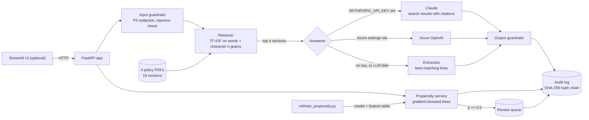

# Insurance Policy Copilot

A small, working example of two things an insurer's service team might want from GenAI and ML,
built with the controls I'd expect before either goes near a customer:

1. **Policy Q&A.** Ask a question about the policy documents and get a short answer that cites
   the document, page and section it came from. With an Anthropic API key it uses Claude;
   without one it falls back to an offline answerer, so the project runs anywhere.
2. **Surrender (retention) risk.** A model scores a customer's active policies for the chance
   of surrender in the next 90 days, explains the top factors, and holds high-risk
   recommendations for a person to approve before anyone calls the customer.

Around both: PII redaction, prompt-injection checks, a tamper-evident audit log, a human
review queue, and evals that run in CI.

All data is synthetic: four made-up policy PDFs and generated customers. No real customer
data, and none of the numbers below describe real-world performance.

## Architecture



## Quick start

Needs Python 3.11 or 3.12.

```bash
git clone https://github.com/sumankrsh/insurance-policy-copilot.git
cd insurance-policy-copilot
python3 -m venv .venv && source .venv/bin/activate
pip install -r requirements.txt
python -m ml.train_propensity     # about 15 s: synthetic data and model
uvicorn app.main:app --port 8000
```

Then open http://localhost:8000/docs, or try:

```bash
curl -s localhost:8000/ask -H 'content-type: application/json' \
  -d '{"question": "How long is the free-look period?"}'
curl -s -X POST localhost:8000/customers/C010020/propensity
```

To use Claude for answers, set `ANTHROPIC_API_KEY` before starting the API (or copy
`.env.example` to `.env`). For Azure OpenAI, `pip install -r requirements-azure.txt` and set the
`AZURE_OPENAI_*` variables. `GET /health` shows which answerer is active.

Optional web UI, in a second terminal:

```bash
pip install -r requirements-ui.txt
streamlit run ui/streamlit_app.py   # http://localhost:8501
```

Or with Docker (the image trains the model at build time):

```bash
docker build -t policy-copilot . && docker run -p 8000:8000 policy-copilot
```

Tests: `pip install -r requirements-dev.txt && pytest`.

## Example

`POST /ask` with `{"question": "How long is the free-look period? I'm on 9876543210."}`, offline mode:

```json
{
  "answer": "From the policy documents:\n- Free-Look Period: The policyholder has 15 days from policy receipt to review and return if not satisfied. [1]",
  "found": true,
  "citations": [
    {
      "n": 1,
      "document": "Term Life Insurance Policy",
      "source_file": "term_life_insurance_policy.pdf",
      "page": 3,
      "section": "Section 6: Terms and conditions",
      "quote": "Free-Look Period: The policyholder has 15 days from policy receipt to review and return if not satisfied."
    }
  ],
  "provider": "extractive",
  "guardrails": ["pii_redacted"]
}
```

The phone number was replaced with `[PHONE]` before retrieval, before any LLM call and before the
audit log; the `guardrails` field records that it happened.

`POST /customers/C010020/propensity` (first policy only):

```json
{
  "customer_id": "C010020",
  "model_version": "gradient_boosting-seed42-n20000",
  "policies": [
    {
      "policy_id": "P00024608",
      "policy_type": "Health",
      "probability": 0.652,
      "risk_tier": "high",
      "top_factors": [
        {"feature": "surrender_queries_12m", "description": "surrender-related contacts in the last year", "value": 1.0, "typical_value": 0.0, "effect": 0.254},
        {"feature": "payment_gaps", "description": "missed premium payments on this policy", "value": 2.0, "typical_value": 0.0, "effect": 0.176},
        {"feature": "tenure_months", "description": "months since the policy started", "value": 36.0, "typical_value": 33.0, "effect": 0.077}
      ]
    }
  ],
  "decision": {
    "policy_id": "P00024608",
    "probability": 0.652,
    "risk_tier": "high",
    "recommended_action": "retention_call",
    "needs_human_review": true,
    "status": "pending_human_review",
    "review_id": "714654292e14"
  }
}
```

The recommendation waits in `GET /reviews?status=pending` until someone calls
`POST /reviews/{review_id}` with `{"approve": true, "reviewer": "...", "note": "..."}`.

## Results on synthetic data

Both reports are generated by scripts in this repo and committed in [`reports/`](reports/)
(`python -m ml.train_propensity --report` and `python -m eval.rag_eval`).

**Surrender model** ([`reports/propensity_eval.md`](reports/propensity_eval.md)). 20,000
synthetic customers, 34,298 active policies, split by customer into train / validation / test.

| Scores on the test split (6,772 policies) | ROC AUC | PR AUC | Brier |
|---|---|---|---|
| Logistic regression (baseline) | 0.704 | 0.435 | 0.175 |
| Gradient-boosted trees (served) | 0.732 | 0.472 | 0.168 |
| Ceiling: the generator's own probabilities | 0.746 | 0.494 | 0.164 |

The labels come from a hand-written rule plus noise (`data/synthetic_data.py`), so the honest
reading is "the model recovers most of the rule": it gets within about 0.015 AUC of the ceiling. On
the test split, the 5.1% of policies scored high risk surrendered at 62.9%, against a 26.0% base
rate; the 44% scored low risk surrendered at 11.4%.

**Policy Q&A** ([`reports/rag_eval.md`](reports/rag_eval.md)). 40 questions I wrote against the
four documents: 32 they answer, 8 they don't.

| Offline (extractive) answerer | Result |
|---|---|
| Right document retrieved first | 32 / 32 |
| Answer contains the expected fact | 30 / 32 |
| Answer cites the expected document | 32 / 32 |
| Unanswerable question correctly answered "not found" | 4 / 8 |
| Median time per question | about 5 ms |

The weak spot is the last row: without an LLM, the system often quotes the nearest line instead
of saying it doesn't know. The Claude prompt asks for `NOT_FOUND` in that case, but I haven't
measured how well that works yet: the API key available when I built this had no credit, so the
Claude path is covered by tests against a stubbed client, not by a live eval run.
`python -m eval.rag_eval --provider anthropic` runs it (40 calls).

## Design notes

**Grounded answers.** Retrieved sections go to Claude as `search_result` blocks with citations
enabled, so each cited span is a verbatim quote from a section the system retrieved. The
prompt treats excerpts as reference text, not instructions, and asks for `NOT_FOUND` when they
don't answer the question. If nothing relevant is retrieved, no LLM call is made. If the LLM
call fails, Claude declines, or an answer comes back with no valid citation, the API returns the
extractive answer instead and records why. The request opts into Anthropic's server-side
fallback model for safety-classifier declines. Sampling parameters such as `temperature` are not
sent; current Claude models reject them.

**Retrieval.** One chunk per section per page (19 in total), indexed with TF-IDF on words and on
character n-grams. It needs no model download, runs offline in milliseconds, and is
deterministic, which keeps the tests and CI simple. It matches words, not meaning, so
paraphrased questions can miss; an embedding model would be the next step for a larger corpus.

**Guardrails** (`app/guardrails.py`). Input: regex-based PII redaction (email, phone, card numbers
with a Luhn check, Aadhaar, PAN, SSN, and policy/customer/claim IDs), a prompt-injection check that
refuses obvious attempts, a length cap, and detection of requests for personal advice, which adds
a disclaimer to the answer. Output: HTML stripped, PII redacted again, length capped.

**Human review.** Thresholds live in `ml/decision.py`: high risk is a probability of at least
0.5 (more likely than not to surrender), medium is at least 0.25 (above the average surrender
rate). A high-risk score creates one pending review per policy; scoring again doesn't create a
duplicate. Approving or rejecting records who decided and why.

**Audit log** (`app/audit.py`). Every request writes a record: redacted input, retrieved section
IDs and scores, answerer, fallback reason, answer, citations, token usage, latency, and for
scoring the model version, scores and decision. Raw user input is never stored. Each record holds
the SHA-256 of the previous one, so `GET /audit/verify` detects an edited or deleted row. Someone
with write access could still rebuild the whole chain; anchoring the latest hash somewhere
external would close that gap.

**Model.** A scikit-learn `HistGradientBoostingClassifier`, chosen over logistic regression on the
validation split and reported on a test split it never saw. Customers don't span splits. Training
and serving read features through the same module (`ml/features.py`). The "top factors" are
per-policy: how much the score drops when that one feature is set to its training median. That is
simple and model-agnostic, but it ignores interactions between features; SHAP would be more
thorough.

## API

| Method and path | What it does |
|---|---|
| `GET /health` | Status, active answerer, model version |
| `POST /ask` | Answer a question from the documents, with citations |
| `POST /chat` | Single entry point used by the UI; routes by simple rules to Q&A, scoring or policy lookups |
| `POST /customers/{customer_id}/propensity` | Score a customer's active policies |
| `GET /policies/{policy_id}` | Policy summary from the synthetic records |
| `GET /policies/{policy_id}/surrender-value` | Indicative surrender value (fund value minus surrender charge) |
| `GET /reviews?status=pending` | Recommendations waiting for review |
| `POST /reviews/{review_id}` | Approve or reject one |
| `GET /audit?trace_id=...` | Audit records |
| `GET /audit/verify` | Check the hash chain |

## Project layout

```
app/            FastAPI app: documents, retrieval, answerers, guardrails, propensity, audit
ml/             feature definitions, decision thresholds, training script
data/           synthetic data generator, the four policy PDFs and their generator
eval/           Q&A eval questions and runner
reports/        generated eval reports (committed)
tests/          pytest suite (93 tests)
ui/             Streamlit front end
databricks/     optional Databricks notebooks (see its README)
```

## Tests and CI

GitHub Actions runs on Python 3.11 and 3.12: ruff, the pytest suite, model training with a floor
on test AUC (0.70), and the offline Q&A eval with floors on its scores. A second job builds the
Docker image and smoke-tests `/health`, `/ask` and scoring against the running container. The
Claude and Azure answerers are tested with stub clients, so CI needs no API keys.

## Limitations

- Synthetic data throughout. The surrender labels follow a rule I wrote, and the four policy
  documents are short and simple. Real documents (scanned PDFs, long tables, amendments) would
  need better parsing and chunking.
- Lexical retrieval and the offline answerer can't compare across rows, combine facts, or
  reliably recognise questions the documents don't answer.
- The Claude and Azure OpenAI paths are tested against stubbed clients only (see above).
- PII detection is pattern-based. It does not catch names or street addresses; an NER model such
  as Presidio would be needed for that.
- No authentication. The audit, review and scoring endpoints are open, and SQLite suits one
  instance, not a cluster.
- The chat route uses keyword rules and keeps no conversation history.
- The surrender value is indicative, computed from the synthetic policy record, not from each
  policy document's formula.
- The eval questions were written by me while building this, and the offline thresholds were set
  by looking at the same questions.

## Optional: Databricks and MLflow

`python -m ml.train_propensity --mlflow` logs the run, metrics and model to MLflow
(`pip install -r requirements-databricks.txt`; tested against a local MLflow store). The
[`databricks/`](databricks/) folder holds the original Databricks notebooks (Delta tables, feature
tables, XGBoost, model registry). They are not run in CI; their README says what was changed.

## License

MIT, see [LICENSE](LICENSE).

---

Built by Suman Mukherjee · contactme@mukherjeesuman.com · [mukherjeesuman.com](https://mukherjeesuman.com)
